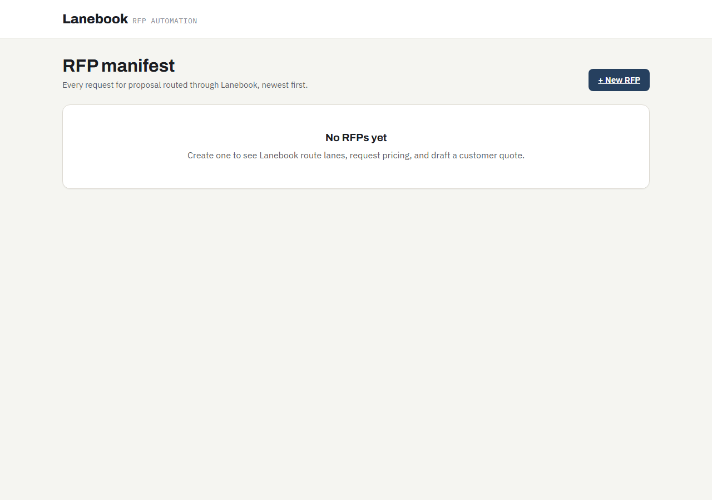
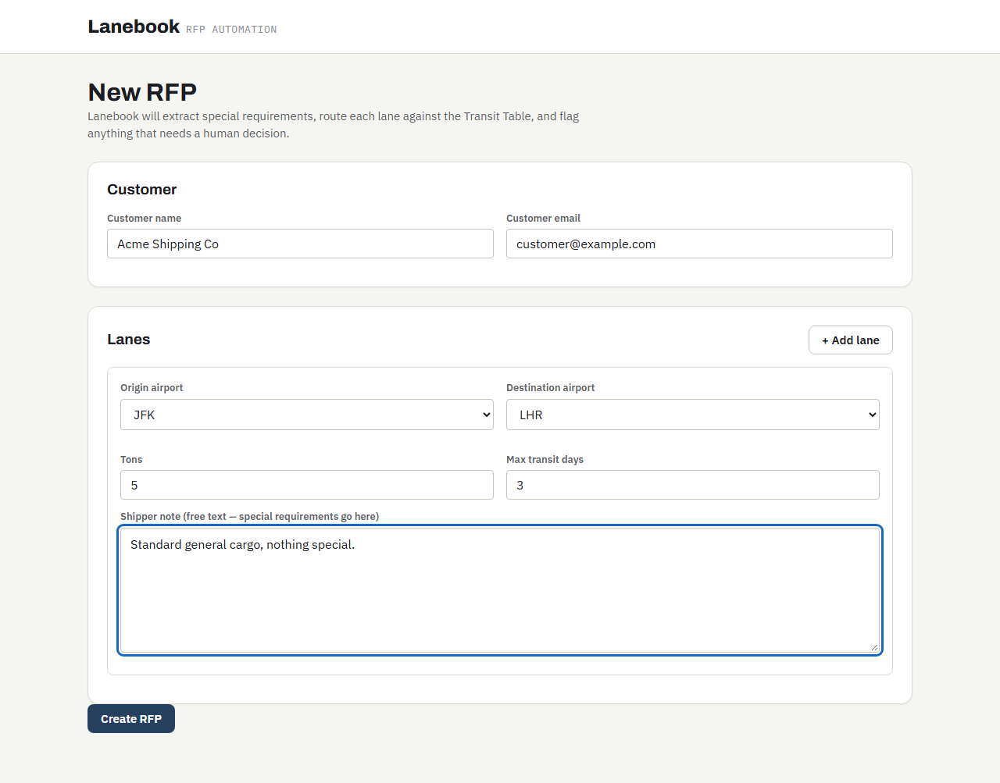
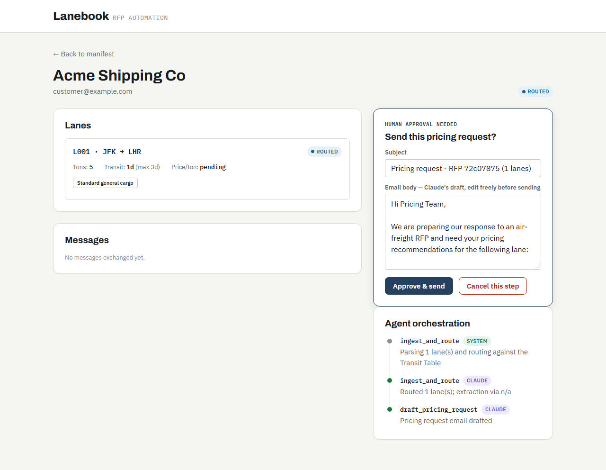
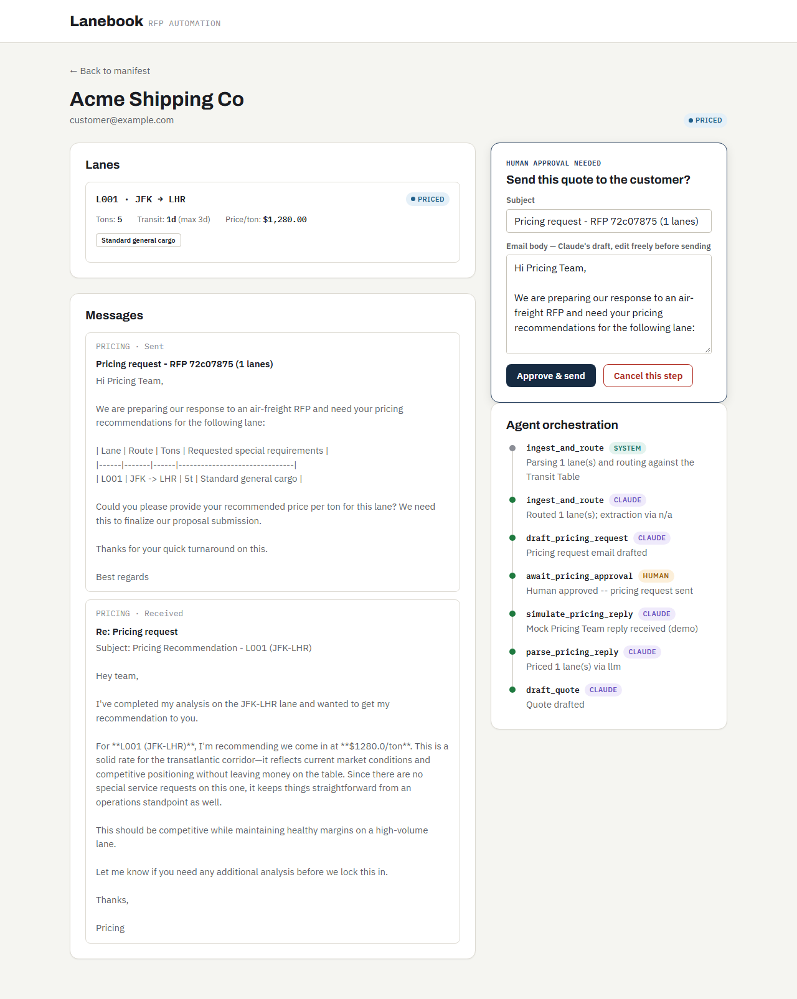
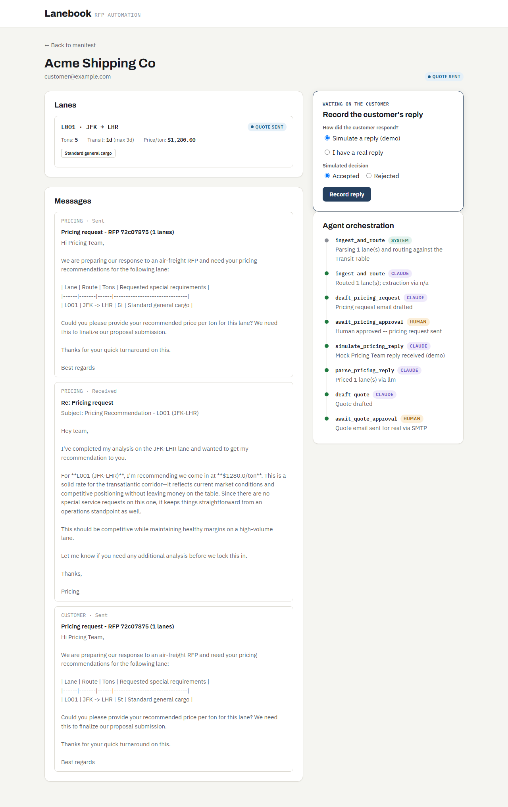
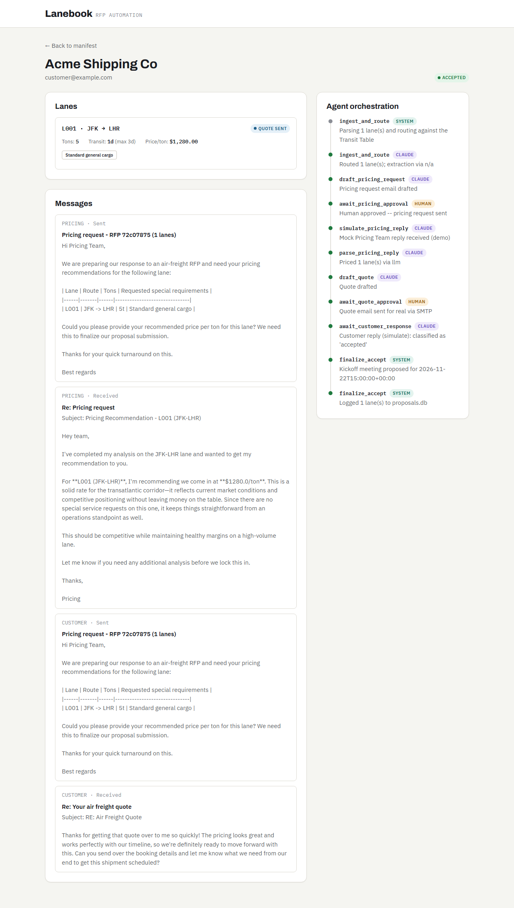
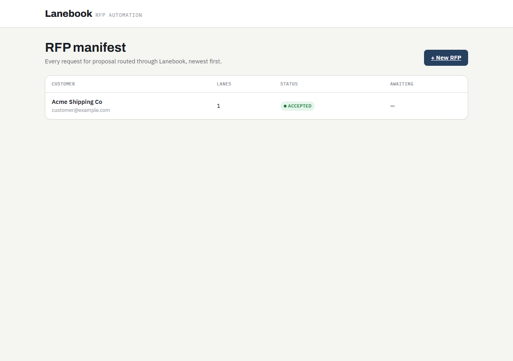
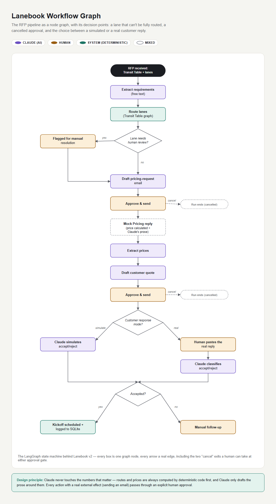
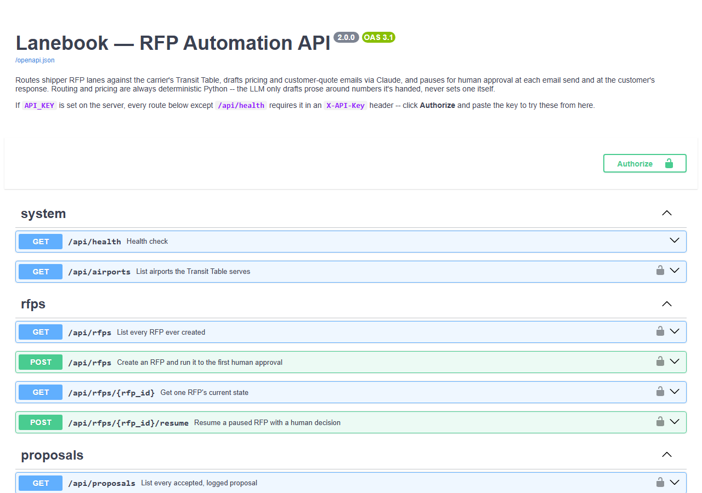
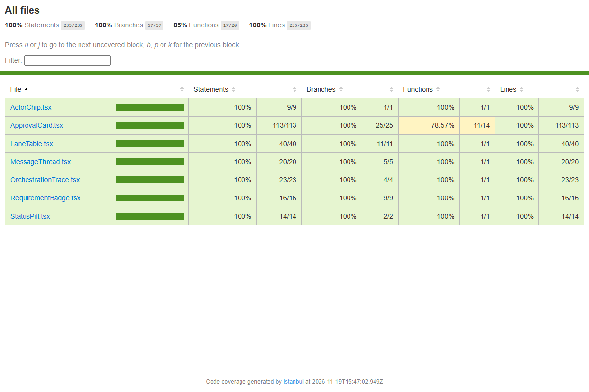

# Lanebook — RFP Automation

Air-freight RFP automation on a local-first stack: **LangGraph** orchestrates
the pipeline as an explicit state machine, **FastAPI** exposes it over HTTP,
and a **React + TypeScript** frontend drives it. SQLite handles persistence,
and the LangGraph checkpointer tracks run state.

Routing a lane through the Transit Table, scoring which special requirements
a route can fulfill, and computing the baseline price per ton are all plain
deterministic Python (`app/transit_graph.py`, `app/pricing_heuristic.py`) —
**never done by the LLM**. Claude's job is narrow: extracting requirements
from free text and drafting the prose of each email, always around numbers
it's handed, never numbers it invents.

## Application flow

A full RFP walked through the UI, start to finish.

**1. Empty dashboard** — nothing created yet.



**2. New RFP** — origin/destination are `<select>`s populated from the
Transit Table, so only real airport codes can be submitted.



**3. First pause: pricing approval** — Claude has already routed the lane
and drafted the email to the Pricing team; the orchestration panel on the
right shows every step so far, color-coded by who/what did it.



**4. Second pause: quote approval** — after a mock Pricing reply and price
extraction, Claude drafts the customer quote. Both this and the pricing
email are editable right here before sending.



**5. Third pause: the customer's reply** — simulate a decision for a demo,
or paste in a real reply for Claude to classify.



**6. Accepted** — the full orchestration trace end to end: every node,
every actor (Claude / Human / System), the complete message thread, and the
final `finalize_accept` entries (kickoff proposed, lane logged to SQLite).



**7. Back on the dashboard** — the completed RFP now shows up in the
manifest.



## Architecture

```
backend/app/
  models.py, transit_graph.py, requirements_catalog.py, pricing_heuristic.py
      deterministic routing/pricing/requirement logic
  data_loader.py, data/transit_table.csv
      the carrier's Transit Table
  state.py        the RfpState TypedDict the graph operates on
  llm.py          thin ChatAnthropic wrapper (langchain-anthropic)
  email_sender.py SMTP send with mock fallback + TEST_EMAIL_OVERRIDE
  db.py           SQLite: accepted-proposal log + an RFP index for the dashboard
  nodes.py        one function per graph node
  graph.py        StateGraph wiring + SqliteSaver checkpointer
  main.py         FastAPI: create / get / resume / list endpoints, auth,
                   rate limiting, security headers

frontend/src/
  domain/     Rfp, Lane, Message, TraceEvent, PendingInterrupt, Proposal --
              the types components work with
  dto/        request-only shapes (LaneDraftDto, CreateRfpRequestDto, ...)
  api/        ApiError, httpClient (getGlobalHttpInstance), endpoints.ts,
              rfpApi.ts, proposalApi.ts -- one typed function per route
  pages/      Dashboard, NewRfp, RfpDetail
  components/ LaneTable, ApprovalCard, OrchestrationTrace, MessageThread, ...
  test/       customRender (Testing Library + MemoryRouter), setup.ts
```

### The graph

```
ingest_and_route → draft_pricing_request → await_pricing_approval (⏸ human)
  → simulate_pricing_reply → parse_pricing_reply → draft_quote
  → await_quote_approval (⏸ human) → await_customer_response (⏸ human/demo)
  → finalize_accept | finalize_reject
```

Each `⏸` is a real `interrupt()` call: the graph suspends, FastAPI returns the
current state plus the pending question, and `POST /api/rfps/{id}/resume`
replays `Command(resume=...)` into the *same* LangGraph thread to continue.
A node that calls `interrupt()` re-runs from its own top on every resume, so
the design splits "do the LLM work" (draft_*) from "wait for a human"
(await_*) into separate nodes — the draft only ever runs once per step.

The customer-response step supports two modes: **simulate** (Claude writes a
plausible accept/reject reply for demo purposes — no real customer exists in
this environment) or **real**, where you paste in an actual reply and Claude
classifies it.

The same graph as a node diagram, with its two decision points (a lane that
can't be fully routed, and the cancel exits at each approval gate):



Interactive version: [`docs/workflow-graph.html`](docs/workflow-graph.html)
(open it directly in a browser — it's a standalone page, no server needed).

## Running locally

Two processes, two terminals: the backend first, then the frontend.

### 1. Backend — http://localhost:8000

```bash
cd backend
python -m venv .venv
.venv/Scripts/activate        # Windows (Git Bash/PowerShell); use `source .venv/bin/activate` on macOS/Linux
pip install -r requirements.txt
cp .env.example .env          # fill in ANTHROPIC_API_KEY at minimum -- see below
python -m uvicorn app.main:app --port 8000
```

Check it came up: `curl http://localhost:8000/api/health` should return `{"ok":true}`.

**`backend/.env`** (copied from `.env.example`):

| Variable | Required | What it does |
|---|---|---|
| `ANTHROPIC_API_KEY` | **Yes** | Claude API key (console.anthropic.com) |
| `ANTHROPIC_MODEL` | No | Default `claude-haiku-4-5` |
| `ANTHROPIC_TIMEOUT_SECONDS` | No | Default `30` |
| `SMTP_HOST` / `SMTP_PORT` / `SMTP_USERNAME` / `SMTP_PASSWORD` / `SMTP_FROM` | No | Omit `SMTP_USERNAME`/`SMTP_PASSWORD` to log quote emails to the console instead of sending them |
| `TEST_EMAIL_OVERRIDE` | No | Redirects every outgoing email here regardless of recipient (subject prefixed with the real intended recipient) |
| `CORS_ORIGIN_REGEX` | No | Default `http://localhost:\d+` |
| `API_KEY` | No, recommended | Requires this exact value in an `X-API-Key` header on every route except `/api/health` |

If `API_KEY` is set, also set the same value in `frontend/.env.local` as
`VITE_API_KEY` so the UI keeps working. Leave both unset to run with no auth
(fine for a throwaway local demo only).

`POST /api/rfps` is capped at 10 requests/minute and `POST
/api/rfps/{id}/resume` at 20/minute per API key (or per IP if no key is
set) — each creates or resumes an LLM-driven run, so this bounds runaway
cost/abuse. Every response also carries a few baseline security headers
(`X-Content-Type-Options`, `X-Frame-Options`, `Referrer-Policy`,
`Cross-Origin-Resource-Policy`).

#### Interactive API docs (Swagger)

`http://localhost:8000/docs` — click **Authorize** and paste `API_KEY` (if
set) to try every route directly from the browser; schemas are real Pydantic
models, not bare objects. ReDoc is at `/redoc`, the raw OpenAPI schema at
`/openapi.json`.



### 2. Frontend — http://localhost:5173

```bash
cd frontend
npm install
cp .env.example .env.local    # VITE_API_BASE_URL, defaults to http://localhost:8000
npm run dev
```

**`frontend/.env.local`** (copied from `.env.example`):

| Variable | Required | What it does |
|---|---|---|
| `VITE_API_BASE_URL` | No | Default `http://localhost:8000` |
| `VITE_API_KEY` | Only if the backend's `API_KEY` is set | Must match it exactly |

Open the URL Vite prints (`5173`, or the next free port if one is already
taken). Click **+ New RFP** and walk a lane through the pipeline: approve the
pricing request, approve the quote, then record a simulated or real customer
reply.

### Stopping

`Ctrl+C` in each terminal. On Windows, if a port is stuck in use from a
previous run: `netstat -ano | grep :8000` (or `:5173`) to find the PID, then
`taskkill //PID <pid> //F`.

## Testing

### Backend — pytest

```bash
cd backend
python -m pytest
```

4 tests in `tests/test_graph_flow.py` drive the compiled graph directly
(`happy path → accept`, `customer rejection`, `unroutable lane flagged for
review`, `pricing cancelled`). Every LLM call falls back to a
keyword/regex/template path on failure, so the suite needs no real
`ANTHROPIC_API_KEY` and makes no network calls.

### Frontend — Vitest

```bash
cd frontend
npm test              # run once
npm run test:watch    # watch mode
npm run test:coverage # run once + coverage report (text + HTML)
```

Each component has a colocated `<Name>.spec.tsx` using React Testing Library
and `@testing-library/user-event`, rendered through a shared `customRender`
(`src/test/customRender.tsx`, wraps `render()` in a `MemoryRouter`).
36 tests, 100% statement/branch/line coverage on every component:



The HTML report (`npm run test:coverage`, then open
`frontend/coverage/index.html`) is regenerated on every run and is
gitignored — the screenshot above is a point-in-time snapshot.
